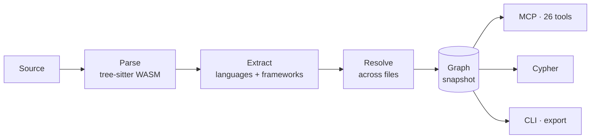
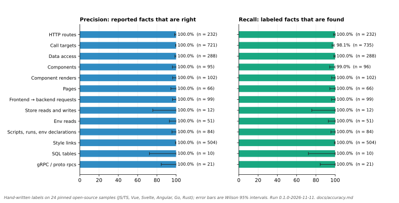
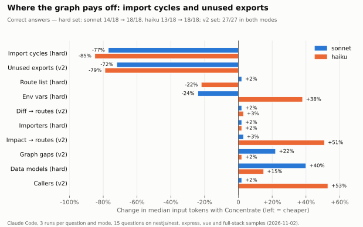
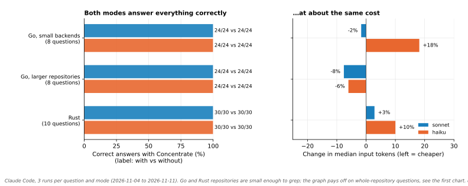
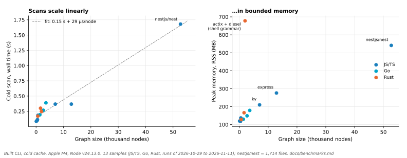

<h1 align="center">Concentrate</h1>

  <b>A code graph for AI agents.</b> 
  Concentrate reads a codebase once and turns it into a queryable graph of files, functions, calls, HTTP routes, dependency injection, environment variables and database access. It then serves that graph to agents over MCP.

  
  
  
  
  

---

## Why

Ask a coding agent *"which tables does `DELETE /articles/:slug` write to?"* or *"what breaks if I change `UsersService`?"* and it starts grepping. It opens files, follows imports by hand and reads far more code than the answer needs. Some questions grep cannot answer at all, such as *"which files import each other in a loop?"*: no single file contains the answer.

Concentrate does that reading ahead of time. It parses the whole repository and resolves names across files. It also understands the frameworks a backend is built on and records the result as a graph. An agent then asks the graph instead of the file system, and a question about the whole repository becomes one tool call.

## What it sees

| | |
| --- | --- |
| **Structure** | files, functions, classes, methods, variables, decorators, imports, exports, entrypoints (Go `main`, gRPC services and cobra commands, Rust `main`, tonic services and clap commands, C++ gRPC service methods, Python `__main__` blocks, Celery tasks and click/typer commands, C and C++ `main` and GoogleTest / Catch2 tests included) |
| **Calls** | call sites resolved to their target declaration across files, barrels and re-exports |
| **HTTP routes** | Express, Koa, Fastify and NestJS, with the full path composed through mounts, prefixes and controllers; Next.js, Nuxt, SvelteKit and Astro server routes, and tRPC procedures; Go `net/http`, gin, echo, chi, fiber, gorilla/mux, go-pkgz/routegroup and kratos, with groups and routers passed between functions; Rust axum, actix-web, Rocket and warp, with nested routers, scopes and `configure` functions; Python Django and Django REST framework, Flask, FastAPI and Starlette, with blueprints, `include_router` prefixes and `url()` includes; C++ Crow, Drogon, Pistache and cpp-httplib |
| **Components** | React, Vue, Svelte, Astro, Angular and web components, and which component renders which, with the props passed |
| **Pages** | Next.js, Nuxt, SvelteKit and Astro file routes; React Router, TanStack Router, Vue Router and Angular Router records, each linked to the component it renders |
| **Frontend requests** | fetch, axios, ky, ofetch, SWR, TanStack Query, Angular `HttpClient` and tRPC calls, and Go `net/http` and resty clients, Rust reqwest, Python requests, httpx and aiohttp, and C and C++ libcurl, cpr and cpp-httplib, linked to the backend route they reach |
| **State stores** | Pinia, Redux Toolkit, Zustand, Jotai and Svelte stores: their state and actions, and the functions and components that read and write them |
| **Dependency injection** | NestJS constructor and property injection chains; Go uber fx and google wire providers; Python dependency-injector and FastAPI `Depends` |
| **Configuration** | `process.env.*` and `import.meta.env` reads; Go `os.Getenv`, viper and env struct tags (caarlos0/env, envconfig); Rust `std::env`, `env!`, clap, envy and the config crate; C and C++ `getenv`, `secure_getenv` and Qt `qgetenv`; Python `os.environ`, `os.getenv`, python-dotenv and pydantic settings; linked to the functions and routes that use them and to the variables `.env` files declare |
| **Data access** | Prisma, TypeORM, Sequelize, Knex, Mongoose and Drizzle; Go gorm, ent, sqlc, `database/sql` and sqlx (literal SQL); Rust sqlx, diesel and SeaORM; Python SQLAlchemy, SQLModel, Django ORM and DB-API SQL; C and C++ sqlite3, libpq, MySQL, SQLiteCpp, libpqxx, SOCI and Qt SQL strings: models, tables, and read and write operations |
| **Scripts and infrastructure** | `package.json` scripts, Makefile targets, shell and PowerShell scripts, Dockerfiles, compose services and GitHub Actions jobs as entrypoints, what each runs, and the env they read and set |
| **Styles** | CSS, SCSS and Less: classes, ids, custom properties and rules, `@import` / `@use` / `url()` to the files they name, and the components and templates that use a class (CSS Modules exactly; `className`, `class`, `:class` and `[ngClass]` by name), so a class or `--property` change has an impact answer |
| **SQL and protobuf** | tables, columns, indexes and migration order from SQL migrations and schema files, merged with the tables code declares; `.proto` services and rpcs linked to the generated Go server interface and the methods that implement them |
| **Workspaces** | packages and the dependencies between them, both declared and used in source |

Languages: TypeScript and JavaScript (JSX/TSX included), HTML pages and single-file components (`.vue`, `.svelte`, `.astro`: their scripts and markup), Python, Go, Rust, C and C++. Framework semantics cover the JavaScript and TypeScript ecosystem, backend and frontend, and Go HTTP routes (`net/http`, gin, echo, chi, fiber, gorilla/mux, routegroup, kratos), entrypoints, env reads, data access, outbound HTTP, gRPC calls between services and dependency injection (fx, wire); Rust adds Cargo workspaces, module trees, traits, enums, attributes and path and method call resolution, and the same framework layer as Go: HTTP routes (axum, actix-web, Rocket, warp), tonic and clap entrypoints, env reads, data access (sqlx, diesel, SeaORM) and outbound HTTP (reqwest); Python adds packages, classes, decorators and typed calls plus HTTP routes (Django and Django REST framework, Flask, FastAPI, Starlette) and entrypoints (Celery tasks, click and typer commands, Django management commands); C and C++ add HTTP routes (Crow, Drogon, Pistache, cpp-httplib), gRPC service methods linked to their stub calls, Qt signals linked to slots, env reads, SQL tables and outbound HTTP (libcurl, cpr), `#include` resolution (through `compile_commands.json`, CMake and Makefile include paths), CMake and Make targets (executables and libraries as packages, an executable running its `main`), namespaces, classes with virtual dispatch, header declarations linked to their definitions, macros and tests ([details](docs/known-limitations.md#c-and-c)); the other languages get structure, imports and calls. Every other file (styles, JSON, YAML, TOML, Markdown, shell, Dockerfile, Makefile, SQL, `.proto`, images) is a `File` node too; [what is read from them](docs/known-limitations.md#non-code-files).

## How it works

Parsing is cached per file and runs on worker threads for large repositories. Resolution always runs over the whole graph, so an incremental scan gives the same result as a full one.

The tools answer whole questions, not single lookups:

- `impact_of`: what a change to a symbol reaches.
- `route_details`: a route's handlers, middleware, downstream call chain, tables and env vars.
- `detect_changes`: the impact of a git diff.
- `find_import_cycles`, `find_unused_exports` and `architecture_overview`: repository-wide analysis.
- `get_symbol_source`: just the code that matters.

Lower-level tools and a Cypher subset are there for everything else.

**Design principles**

- **Precision first.** A wrong fact costs an agent more than a missing one, so the extractors only state what they can resolve.
- **Local and deterministic.** No service, no model in the loop, no network. The same input always gives the same graph.
- **One runtime dependency.** Only `web-tree-sitter` ships, as plain JS and WebAssembly. The graph store, the Cypher engine, file discovery and the CLI are built in, so `npm install` never compiles native code.
- **Always current.** Per-file parse caching and `watch` mode keep the graph in step with the code. Readers never block a running scan.

## Results

Every number below comes from pinned open-source repositories and can be reproduced with one command. Each caption links to the full report, including the weaker numbers.

**The graph is trustworthy.**
- Against hand-written labels, 100% of reported routes, call targets, database accesses, React, Vue, Svelte and Angular components, component renders, pages, frontend → backend API requests and Pinia store reads and writes are correct.
- On the Rust samples (a Conduit backend each in axum + sqlx and actix-web + diesel, and the Next.js frontend against the axum one), 39 routes, 97 data accesses, 5 env reads and 33 frontend requests are all 100% precision and 100% recall; the 47 labeled call sites of the axum sample reach 100% precision and 70% recall ([accuracy.md](docs/accuracy.md)).
- On the Python samples (a Conduit backend each in Django REST framework, Flask and FastAPI, a Next.js frontend against each, and the FastAPI full-stack template), 57 routes, 81 data accesses, 26 env reads and 98 frontend requests are all 100% precision, with recall 100% for routes, env and requests and 85% for data access; the 143 labeled call sites of the Flask and FastAPI backends reach 100% precision and 58.7% and 98.8% recall ([accuracy.md](docs/accuracy.md)).
- Route recall, route full paths, data-access recall and component-render recall (on the RealWorld React, Vue, SvelteKit and Angular frontends) are 100%.
- Call recall is 100% on the 497 labeled call sites with a project target (372 of them in two Go backends, gin and echo); API requests are 100% on 66 (the same Next.js frontend against an Express and a gin backend); the remaining gap (components 99%) is in [accuracy.md](docs/accuracy.md) and the [open issues](https://github.com/fatihserhatturan/concentrate/issues).

**Agents answer what grep cannot see, at a fraction of the cost.** Claude Code (sonnet and haiku) answered 15 questions about [nestjs/nest](https://github.com/nestjs/nest) (1,714 files), express, Vue and a full-stack app three times each, with and without Concentrate. With it:
- import-cycle questions were answered correctly in 12 of 12 runs, against 3 of 12 without, at 77–85% fewer input tokens;
- unused-export questions took 4–6 tool calls instead of 26–36, at 72–79% fewer tokens;
- on the six hard questions, 18 of 18 answers were correct on both models (14 and 13 without).

On callers, impact, diffs and narrow questions an agent with grep reaches the same answers at about the same cost, sometimes more; the full method and per-category results are in [agent-benchmark.md](docs/agent-benchmark.md).

**On Go and Rust the agent is just as right, at about the same cost.** The 26 Go and Rust questions (small RealWorld backends, two larger Go repositories, and Conduit backends in axum + sqlx and actix-web + diesel) were answered correctly in every run, with and without Concentrate (156 of 156 runs per mode, sonnet and haiku together). Those repositories are small enough for grep, so median input tokens moved between −8% and +18%; the graph pays off on whole-repository questions like the cycles above ([agent-benchmark.md](docs/agent-benchmark.md#rust-questions-phase-29)). The 12 Python questions (Conduit backends in FastAPI, Flask and Django, and the Next.js frontend against each) behave the same: 72 of 72 correct per mode on sonnet and haiku, with median input tokens 22–24% lower on impact questions, 23–40% lower on frontend → backend questions and within 3% elsewhere except two runs that read files after a tool call (+21% and +18%) ([agent-benchmark.md](docs/agent-benchmark.md#python-questions-phase-33)).

**Scans are fast and scale linearly.**
- A cold scan of all of nestjs/nest builds 52.7k nodes and 69.5k relationships in 1.7 s, at a peak of 541 MB.
- Small projects take about 0.1 s.
- The Go and Rust samples scan in 0.2–0.4 s: gin (21 files) in 267 ms, echo in 193 ms, the gin + Next.js full-stack sample (83 files) in 389 ms; Rust axum + sqlx (12 files) in 171 ms, actix-web + diesel (65 files) in 248 ms, axum + Next.js (74 files) in 301 ms. One outlier: the actix-diesel sample peaks at 678 MB because its shell scripts load the shell grammar, which costs about 650 MB. Python samples scan in the same range: Flask (30 files) in 169 ms, FastAPI (95 files) in 288 ms, Next.js + FastAPI (about 200 files) in 365 ms; the FastAPI samples peak at 660–800 MB for the same shell-grammar reason (one `.sh` file), the Flask and Django ones under 280 MB.

See [benchmarks.md](docs/benchmarks.md#release-report).

**Answers come back in milliseconds.** On the nestjs/nest graph, the median latency of the 20 MCP tools measured in the 0.1.0 release benchmark is between 0.4 ms and 123 ms. On the Go samples the median of every tool is under 15 ms, and on the Rust samples under 10 ms, except `detect_changes`, which runs `git` (20–30 ms) ([benchmarks.md](docs/benchmarks.md#go-samples-phase-21)).

## Where it is going

The goal is a code graph an agent can rely on as much as on the source itself. That means three things:
- recall as high as precision;
- the backend and frontend semantics agents ask about most;
- easy setup in any MCP client (`concentrate init` writes the configuration for Claude Code, Cursor and Codex).

Done so far: the JS/TS backend, the frontend frameworks (React/Next.js, Vue/Nuxt, Svelte/SvelteKit, Astro, Angular), Go, the non-code files of a project, Rust and Python, plus the agent benchmark v2 and the `init` command.

Next up:
- **C/C++** (M13, [#211](https://github.com/fatihserhatturan/concentrate/issues/211)–[#214](https://github.com/fatihserhatturan/concentrate/issues/214)): the language, CMake and Make, the common HTTP and RPC frameworks, Qt signals, data access, env and outbound HTTP are read; the measurement phase ([#214](https://github.com/fatihserhatturan/concentrate/issues/214)) is not done yet.

Publishing to npm is not planned for now.

The full plan is in [docs/ROADMAP.md](docs/ROADMAP.md).

## Documentation

| | |
| --- | --- |
| [Getting started](docs/getting-started.md) | install, scan, query, watch, and connect an agent |
| [MCP server](docs/mcp-server.md) | client setup and the reference for all 26 tools |
| [Cypher subset](docs/cypher.md) | querying the graph directly |
| [Architecture](docs/architecture.md) | the scan pipeline and source layout |
| [Accuracy](docs/accuracy.md) · [Benchmarks](docs/benchmarks.md) · [Agent benchmark](docs/agent-benchmark.md) | how the numbers above are measured |
| [Known limitations](docs/known-limitations.md) | what the graph does not see yet |
| [Roadmap](docs/ROADMAP.md) | phases and status |
| [Contributing](CONTRIBUTING.md) | development setup, tests and ground rules |

All documents are indexed in [docs/README.md](docs/README.md).

## License

[MIT](LICENSE)
