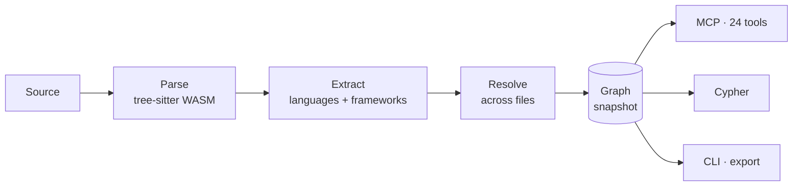
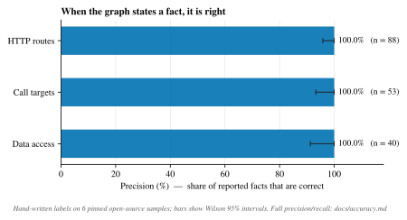
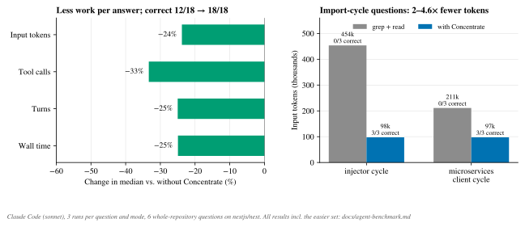

<h1 align="center">Concentrate</h1>

  <b>A code graph for AI agents.</b> 
  Concentrate reads a codebase once and turns it into a queryable graph of files, functions, calls, HTTP routes, dependency injection, environment variables and database access. It then serves that graph to agents over MCP.

  
  
  
  
  

---

## Why

Ask a coding agent *"which tables does `DELETE /articles/:slug` write to?"* or *"what breaks if I change `UsersService`?"* and it starts grepping. It opens files, follows imports by hand and reads far more code than the answer needs. Some questions grep cannot answer at all, such as *"which files import each other in a loop?"*: no single file contains the answer.

Concentrate does that reading ahead of time. It parses the whole repository and resolves names across files. It also understands the frameworks a backend is built on and records the result as a graph. An agent then asks the graph instead of the file system, and a question about the whole repository becomes one tool call.

## What it sees

| | |
| --- | --- |
| **Structure** | files, functions, classes, methods, variables, decorators, imports, exports, entrypoints |
| **Calls** | call sites resolved to their target declaration across files, barrels and re-exports |
| **HTTP routes** | Express, Koa, Fastify and NestJS, with the full path composed through mounts, prefixes and controllers |
| **Dependency injection** | NestJS constructor and property injection chains |
| **Configuration** | `process.env.*` reads, linked to the functions and routes that use them |
| **Data access** | Prisma, TypeORM, Sequelize, Knex, Mongoose and Drizzle: models, tables, and read and write operations |
| **Workspaces** | packages and the dependencies between them, both declared and used in source |

Languages: TypeScript and JavaScript (JSX/TSX included), HTML pages and single-file components (`.vue`, `.svelte`, `.astro`: their scripts and markup), Python, Go and Rust. Framework semantics are currently strongest for Node.js and TypeScript backends.

## How it works

Parsing is cached per file and runs on worker threads for large repositories. Resolution always runs over the whole graph, so an incremental scan gives the same result as a full one.

The tools answer whole questions, not single lookups:

- `impact_of`: what a change to a symbol reaches.
- `route_details`: a route's handlers, middleware, downstream call chain, tables and env vars.
- `detect_changes`: the impact of a git diff.
- `find_import_cycles`, `find_unused_exports` and `architecture_overview`: repository-wide analysis.
- `get_symbol_source`: just the code that matters.

Lower-level tools and a Cypher subset are there for everything else.

**Design principles**

- **Precision first.** A wrong fact costs an agent more than a missing one, so the extractors only state what they can resolve.
- **Local and deterministic.** No service, no model in the loop, no network. The same input always gives the same graph.
- **One runtime dependency.** Only `web-tree-sitter` ships, as plain JS and WebAssembly. The graph store, the Cypher engine, file discovery and the CLI are built in, so `npm install` never compiles native code.
- **Always current.** Per-file parse caching and `watch` mode keep the graph in step with the code. Readers never block a running scan.

## Results

Every number below comes from pinned open-source repositories and can be reproduced with one command. Each caption links to the full report, including the weaker numbers.

**The graph is trustworthy.**
- Against hand-written labels, 100% of reported routes, call targets, database accesses, React and Vue components, component renders, pages and frontend → backend API requests are correct.
- Route recall, route full paths, data-access recall and component-render recall (on the RealWorld React and Vue frontends) are 100%.
- Call recall (73.6%) is still growing; see [accuracy.md](docs/accuracy.md) and the [open issues](https://github.com/fatihserhatturan/concentrate/issues).

**Agents answer whole-repository questions correctly, with less work.** Claude Code answered six questions about [nestjs/nest](https://github.com/nestjs/nest) (1,714 files) three times each, with and without Concentrate. With it:
- 18 of 18 answers were correct, against 12 of 18 without;
- the median answer used 24% fewer input tokens and 33% fewer tool calls;
- on import-cycle questions, which grep cannot answer, every answer was complete, at 2–4.6× fewer tokens.

On narrow questions over small repositories both setups do about equally well (39/39 against 38/39 correct); the full method and results are in [agent-benchmark.md](docs/agent-benchmark.md).

**Scans are fast and scale linearly.**
- A cold scan of all of nestjs/nest builds 52.7k nodes and 69.5k relationships in 1.7 s, at a peak of 541 MB.
- Small projects take about 0.1 s.

See [benchmarks.md](docs/benchmarks.md#release-report).

**Answers come back in milliseconds.** On the nestjs/nest graph, the median latency of the 20 MCP tools measured in the 0.1.0 release benchmark is between 0.4 ms and 123 ms.

## Where it is going

The goal is a code graph an agent can rely on as much as on the source itself. That means three things:
- recall as high as precision;
- the backend and frontend semantics agents ask about most;
- easy installation in any MCP client.

Next up, in this order:
- **Agent benchmark v2** ([#73](https://github.com/fatihserhatturan/concentrate/issues/73)): call-resolution and graph-gap questions, more models, per-category results.
- **The whole JS/TS ecosystem** (M8, [#75](https://github.com/fatihserhatturan/concentrate/issues/75)–[#82](https://github.com/fatihserhatturan/concentrate/issues/82)): React/Next.js, Vue/Nuxt, Svelte/SvelteKit, Astro, Angular and vanilla JS, with components, pages, stores, DOM events and frontend → backend API links.
- **Distribution** (Phase 9): npm publishing, an `init` command and CI ([#16](https://github.com/fatihserhatturan/concentrate/issues/16)).

The full plan is in [docs/ROADMAP.md](docs/ROADMAP.md).

## Documentation

| | |
| --- | --- |
| [Getting started](docs/getting-started.md) | install, scan, query, watch, and connect an agent |
| [MCP server](docs/mcp-server.md) | client setup and the reference for all 24 tools |
| [Cypher subset](docs/cypher.md) | querying the graph directly |
| [Architecture](docs/architecture.md) | the scan pipeline and source layout |
| [Accuracy](docs/accuracy.md) · [Benchmarks](docs/benchmarks.md) · [Agent benchmark](docs/agent-benchmark.md) | how the numbers above are measured |
| [Known limitations](docs/known-limitations.md) | what the graph does not see yet |
| [Roadmap](docs/ROADMAP.md) | phases and status |
| [Contributing](CONTRIBUTING.md) | development setup, tests and ground rules |

All documents are indexed in [docs/README.md](docs/README.md).

## License

[MIT](LICENSE)
